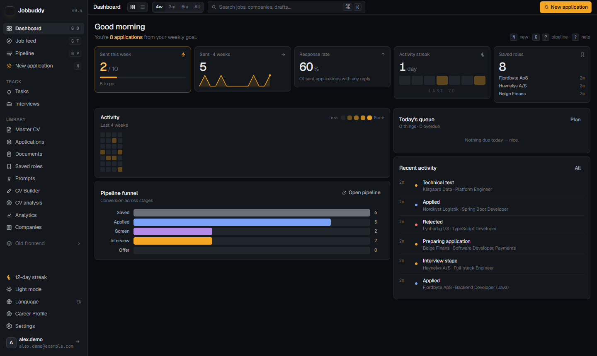
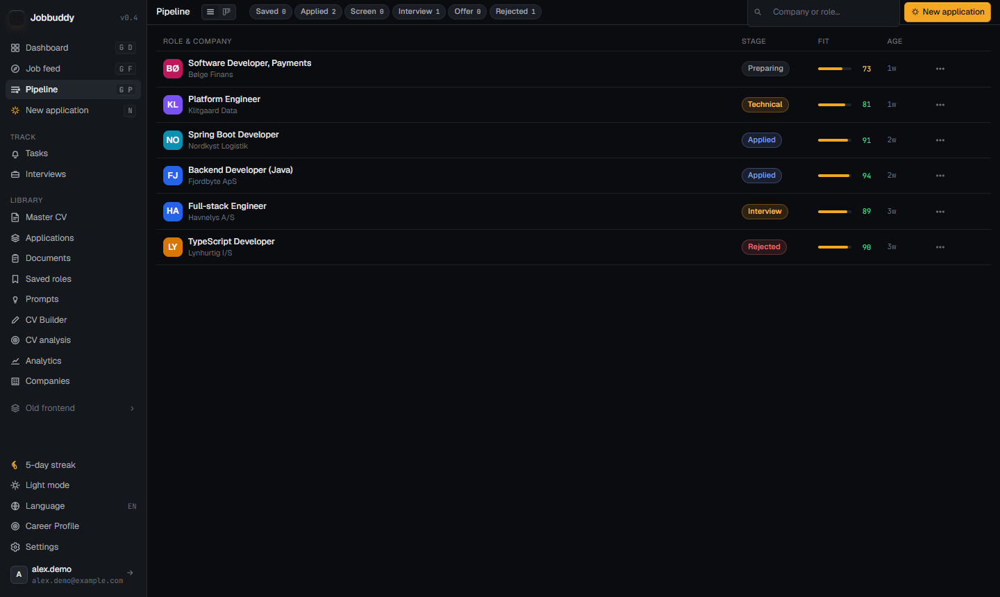
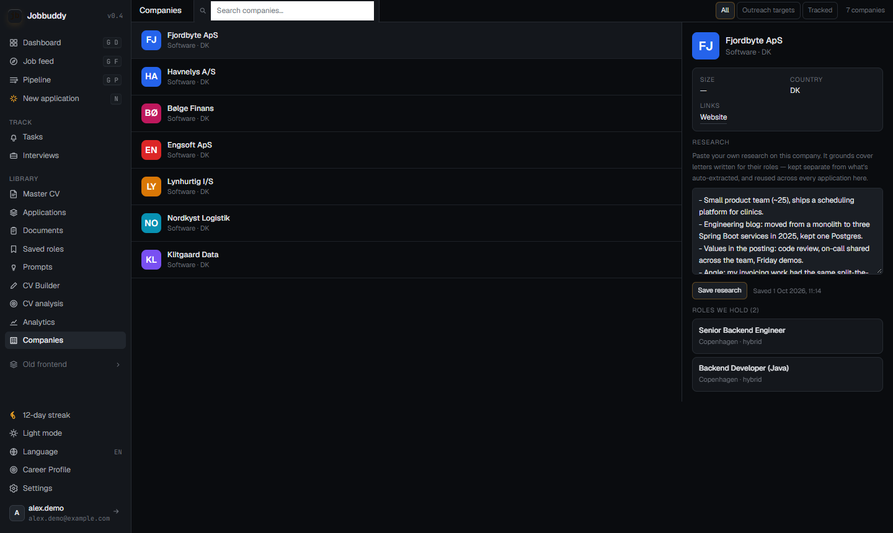

# Jobbuddy

I built Jobbuddy for my own job search, because tailoring a CV and cover letter to every single posting by hand gets old fast. It pulls in job postings, keeps a structured career profile, and uses AI to draft a tailored CV, cover letter and ATS (Applicant Tracking System) report for a specific posting, exported as PDFs.

It used to be called AutoApplicant. The Java package (`com.autoapplicant`) and the default database name still carry that name.



| Pipeline | Company research notes |
|---|---|
|  |  |

Screenshots are from a local run with a made-up account, companies and postings, signed in through the Firebase Auth emulator and with no AI key, so nothing AI-generated is shown.


## What it does

- Career profile with experience, education, skills and projects. You can bootstrap it by parsing an existing CV.
- Job discovery: a crawler over Jobindex, Jobnet, IT-Jobbank, Jobdanmark and a few ATS boards, plus Postgres full-text and pgvector semantic search.
- LinkedIn connector: personal-use and low-volume, over LinkedIn's public `jobs-guest` endpoints, driven by LLM-generated keyword plans per user. It runs on its own jittered schedule, separate from the shared crawl (see `docs/guides/db.md` and `app.linkedin.*` in `application.yml`).
- Document generation: CVs and cover letters tailored to one posting. An optional drafter/reviewer loop critiques and revises each draft before it's assembled.
- ATS reports on how well a generated document matches the posting.
- Guardrails against the model making stuff up: anti-fabrication rules (including not conflating tools of the trade), scraped job text treated as untrusted input, and a deterministic fact gate that flags metrics the profile doesn't support. The fact gate is plain code, no model call.
- Pluggable providers: OpenAI, Gemini, or a local CLI agent (Claude Code / Codex) so generation can run on a flat-fee subscription instead of per-call API billing. Embeddings always use a real API.
- All AI output is structured JSON, assembled server-side into a `StructuredDocument` (identity, sections, rendering options), then rendered to PDF with either an ATS-friendly or a designed template.
- Name, email, phone, photo and links are never sent to the AI provider. Identity is merged into the document after the AI call.
- Firebase JWT auth, optional LinkedIn integration, and an OpenAPI spec with Swagger UI.

## Stack

| Layer | Technology |
|---|---|
| Backend | Java, Spring Boot, Gradle (multi-module) |
| Architecture | Hexagonal (ports and adapters): `domain` / `port` / `usecase` / `adapter` |
| Frontend | Angular (standalone components, lazy-loaded routes) |
| Database | PostgreSQL with Flyway migrations |
| Search | Postgres full-text (`danish` config) + pgvector (`text-embedding-3-small`) |
| AI | OpenAI / Gemini API, or a local CLI agent (Claude Code / Codex) for generation |
| Auth | Firebase Authentication (JWT), optional LinkedIn OAuth |
| Docs | Springdoc OpenAPI / Swagger UI |
| Infra | Docker Compose (Postgres, backend, frontend) |

## Architecture

The backend is hexagonal. Anything crossing a boundary goes through a port interface:

```
adapter/            Spring controllers, JPA adapters, AI client, crawler, PDF renderer
  web/controller/   REST endpoints, depend on port/in interfaces only
  persistence/      JPA entities + adapters implementing port/out
  ai/               OpenAI client implementing AiProviderPort
  crawler/          Job posting crawler
  pdf/              PDF rendering
port/
  in/               Use case interfaces (what the application can do)
  out/              Repository/external service interfaces (what the app needs)
usecase/            Business logic, implements port/in, depends only on port/out
domain/             Plain records/value objects, no framework dependencies
```

The frontend follows the same idea: `core/api` (HTTP services), `core/models` (interfaces mirroring the backend records), `features` (routed components), `shared/components` (presentational).

## Running it

Full stack in Docker:

```bash
cp .env.example .env   # then fill in secrets
docker compose --env-file .env -f infra/docker-compose.yml up --build
```

Or locally, with only Postgres in Docker:

```bash
docker compose --env-file .env -f infra/docker-compose.yml up postgres -d

./gradlew :backend:bootRun                       # backend
cd frontend && npm install && npm run start:local  # frontend
```

| Service | URL |
|---|---|
| Frontend | http://localhost:4200 |
| Backend API | http://localhost:8080/api/v1 |
| Swagger UI | http://localhost:8080/swagger-ui.html |

### Configuration

You need:

- `OPENAI_API_KEY`, with access to `gpt-4o` and `text-embedding-3-small`
- a Firebase service account JSON at `.secrets/firebase-service-account.json`

Optional: `DB_*`, `LINKEDIN_CLIENT_ID`/`SECRET`, `ALLOWED_ORIGINS` (all have local defaults).

AI provider and feature toggles (optional, with defaults):

- `GENERATION_AI_PROVIDER`: `openai` (default), `gemini`, or `claude-cli` / `codex` / `cli` for a local agent. `ENRICHMENT_AI_PROVIDER` has to stay a real API because it produces embeddings.
- `ENRICHMENT_CHAT_AI_PROVIDER`: provider for the chat side of enrichment and company research (`openai`, `gemini`, `claude-cli`, `codex`; blank follows `ENRICHMENT_AI_PROVIDER`). Set it to `claude-cli` to keep everything except embeddings on a subscription.
- `AI_CLI_COMMAND`: optional override of the local-agent command line (prompt piped to stdin). Blank picks a sandboxed default per provider: Claude Code with no tools, no MCP servers, no session transcript and none of the user's own Claude Code settings (`--setting-sources=`), or Codex under a read-only sandbox. An override replaces those flags, so it has to carry its own.
- `AI_CLI_MODEL`: Claude model for the default command, passed as `--model` (default `sonnet`, so generation does not run on the user's own default model). Not applied to `codex` or to an `AI_CLI_COMMAND` override.
- `AI_CLI_MODEL_LABEL`: model name recorded in the usage log and on saved documents. Blank uses the pinned model, or `cli-agent` when the app does not choose one.
- `AI_CLI_TIMEOUT_SECONDS`: limit per local-agent call (default `120`).
- `AI_REQUEST_TIMEOUT_SECONDS`: how long an AI request waits before answering 504 (default `390`: company research, generation and review are up to three CLI calls).
- `AUTO_REVIEW_ENABLED`: the reviewer critique/revise pass after generation (default `true`; each pass is one extra LLM call).
- `FACT_GUARD_ENABLED` / `FACT_GUARD_MODE`: the fact gate on generated metrics (`warn` by default, or `block`).
- `LINKEDIN_SCRAPER_ENABLED`, `LINKEDIN_LOCATIONS`: the LinkedIn connector (see `app.linkedin.*` in `application.yml`).
- `APP_DATA_DIR`: writable directory for uploads and logs (default: the working directory). `LOG_DIR` still overrides the log location on its own.

### Desktop profile

`--spring.profiles.active=desktop` runs the backend on the user's own PC for one user, started by the desktop shell. It needs no Firebase project:

- There is one local user (`local@jobbuddy.invalid`, role `USER`), created on first start.
- The server listens on `127.0.0.1` only. Every request, `/uploads` and `/actuator/health` included, must come from loopback and carry the shell's per-launch token in an `X-JobBuddy-Token` header. Anything else gets 403.
- CORS admits only the shell's origin.
- A scheduled workflow crawls every source except LinkedIn, and also checks posting URLs and expires stale postings, so those schedules are off here. LinkedIn planning and crawling stay on: the keyword plans need the user's Claude login, and LinkedIn is gentler on a residential IP. The enrichment and embedding sweeps and the reminders also run.

Environment:

- `JOBBUDDY_DESKTOP_TOKEN` (required): a random secret of at least 32 characters, generated by the shell for each launch. The app refuses to start without it.
- `DESKTOP_SHELL_ORIGIN`: the origin the shell's UI is served from (default `app://jobbuddy`).
- `APP_DATA_DIR`: defaults to `%LOCALAPPDATA%\JobBuddy`, since the install folder is not writable.
- `GENERATION_AI_PROVIDER` and `ENRICHMENT_CHAT_AI_PROVIDER` default to `claude-cli`. Embeddings still need `OPENAI_API_KEY` (or `GEMINI_API_KEY` with `ENRICHMENT_AI_PROVIDER=gemini`).
- `DB_URL`, `DB_USER`, `DB_PASS`: the install's own database.
- `SERVER_PORT`: the shell passes `0`, so the OS picks a free port as the server binds it. Once it takes requests, the backend prints `JOBBUDDY_DESKTOP_READY port=<n>` on stdout, and the shell connects only to that port. No other process can write to the child's stdout, so a process that grabbed a port first never gets the token.

### Desktop app (Windows)

`desktop/` is the Electron shell around the desktop profile: one installer with a bundled Temurin JRE, the backend jar and the Angular build.

- **Starting:** it checks that `claude` is installed and logged in and that Git for Windows is there, and shows each fix in plain Danish. On first run it asks for the database connection and the embeddings key, and stores them encrypted with Electron `safeStorage` (Windows DPAPI) in `%APPDATA%\JobBuddy`. Then it starts the backend with a fresh token and loads the UI from `app://jobbuddy`. The shell adds `X-JobBuddy-Token` to requests for the backend's exact origin only.
- **Running:** closing the window keeps JobBuddy in the tray ("Åbn", "Start med Windows", "Afslut"), so enrichment, LinkedIn and reminders keep running. Due reminders appear as Windows notifications. "Afslut" kills the backend's whole process tree, and the backend also stops by itself when its stdin closes, so a crashed shell leaves no JVM behind. A start at Windows login runs the backend even when a check fails, and says so from the tray.
- **Checks and restarts** read PATH from the registry, not the shell's own environment, so Git or Claude Code installed while JobBuddy runs is found by "Tjek igen" and "Start igen".
- **The window:** the UI, fonts included, is served from the app itself under a Content-Security-Policy that allows scripts only from the app and requests only to the backend. Every web permission is denied except clipboard writes from the app (its copy buttons). Mail and phone links open in her own programs; nothing else leaves the window. The installed app has no DevTools and no menu.
- **If it breaks:** a crash shows a Danish error screen with the log path, `%LOCALAPPDATA%\JobBuddy\logs\desktop-backend.log`.

Build on Windows with `mise run desktop:package`. It writes `desktop/dist/JobBuddy-Setup-<version>.exe`, a one-click installer for the current user only, so it never asks for administrator rights. `mise run desktop:build` followed by `mise run desktop:start` runs it from the checkout.

The installer's exe has Electron's fuses set: no `ELECTRON_RUN_AS_NODE`, no `NODE_OPTIONS`, no `--inspect`, and the app loads only from its asar. The package task reads the fuses back and fails if any is off. The installed app also exits when started with `--remote-debugging-port` or `--remote-debugging-pipe`, which no fuse covers. To debug, run it from the checkout with `mise run desktop:start`.

**Updating.** There is no auto-update: it needs a code-signing certificate and a release feed, and we have neither. To update, build the new installer and run it over the old install. Her connection, data and logs live outside the install folder, so they are kept. The installer is unsigned, so Windows SmartScreen asks once per new version: "Flere oplysninger", then "Kør alligevel".

## Tests

```bash
./gradlew :backend:test          # backend: unit, web-layer, ArchUnit and Postgres integration tests
cd frontend && npm run test:ci   # frontend, headless
cd frontend && npm run lint      # lint
```

Persistence tests run against a real `pgvector/pgvector:pg16` container (Testcontainers) migrated by Flyway, so full-text ranking, vector search and the migrations are tested on actual Postgres. They need Docker and get skipped locally without it; CI always runs them. `HexagonalArchitectureTest` (ArchUnit) enforces the layering above, and a full test run fails if line coverage drops below the JaCoCo floor in `backend/build.gradle.kts` (only ever raise it).

## Docs

The rest lives in [`docs/`](docs/) (start at the [index](docs/README.md)): `specs/`, `architecture/`, `guides/` (setup, commands, testing, db), `product/` (strategy, features, notes on the Danish job market) and `archive/` for old material. Agent guidance is in [`CLAUDE.md`](CLAUDE.md).
